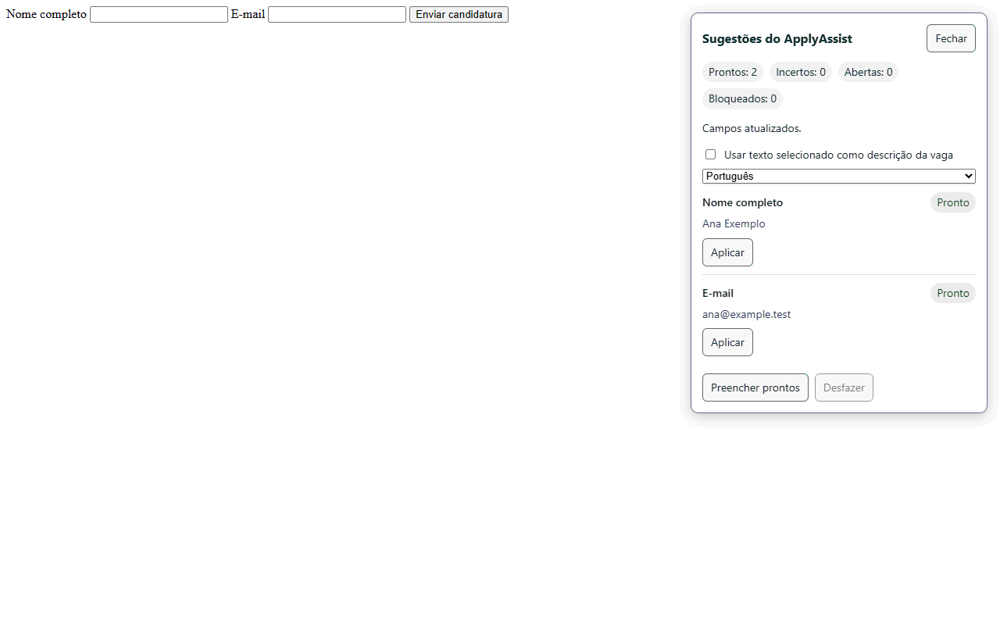
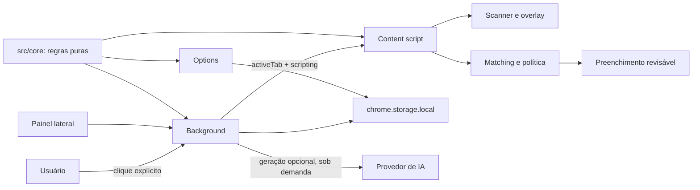

# ApplyAssist

Extensão para Chrome que ajuda a preencher formulários de candidatura com dados do seu perfil. **Você revisa e envia; o ApplyAssist nunca envia formulários.**

> Projeto de portfólio. A extensão é experimental: revise os dados e os termos de cada site antes de usar.



## O que faz

- Só atua depois de você clicar no ícone da extensão; analisa campos visíveis da página atual.
- Sugere dados do perfil local e permite preencher campos individualmente ou os campos prontos.
- Mostra o que foi encontrado para você revisar e permite desfazer o preenchimento.
- Funciona sem IA. A geração opcional de rascunhos exige uma ação explícita e uma conexão configurada.
- Não clica em controles da página, não envia candidaturas e não lê automaticamente descrições de vagas.

## Arquitetura



O núcleo em `src/core` não depende do Chrome nem do DOM. As entradas da extensão compõem o núcleo com adaptadores de armazenamento local e, opcionalmente, de IA. A injeção do content script ocorre após o clique do usuário, sem scripts de conteúdo permanentes.

## Instalação local (desenvolvimento)

Requisitos: Windows, Chrome atual e Node.js 24.

1. Clone o repositório e instale as dependências:

   ```powershell
   git clone https://github.com/andlopper/applyassist.git
   cd applyassist
   npm ci
   ```

2. Gere a extensão:

   ```powershell
   npm run build
   ```

3. Abra `chrome://extensions`, habilite **Modo do desenvolvedor**, clique em **Carregar sem compactação** e selecione a pasta `dist` deste repositório.
4. Fixe o ApplyAssist na barra do Chrome. Em uma página compatível, clique no ícone para ativar a análise; revise as sugestões antes de aplicá-las.

Esta instalação é local e voltada a desenvolvimento; não há instrução de instalação pela Chrome Web Store. Para executar os portões de qualidade e os testes E2E:

```powershell
npm run gates
npx playwright install chromium
npm run e2e
```

## Conformidade e limites

O status abaixo reflete a revisão registrada em [docs/COMPLIANCE.md](docs/COMPLIANCE.md), feita em 22/10/2026. Não é aconselhamento jurídico; os termos podem mudar.

| Site | Status | Como o ApplyAssist se comporta |
|---|---|---|
| LinkedIn | Bloqueado | Não injeta código nem lê a página. O ícone abre o modo colar, sem acesso ao site. |
| Gupy e Vagas.com | Verificados | Uso acionado pelo usuário; confira os termos atuais antes de usar. |
| Indeed, InHire, Sólides, Catho, InfoJobs e sites de empresas | Não verificados | Revise os termos do site. Um aviso pode ser dispensado nas opções, mas isso não significa que o site foi verificado. |

O suporte depende dos campos visíveis e dos recursos da página. A extensão não preenche senhas, dados bancários, CAPTCHA, arquivos ou caixas de consentimento; não automatiza envio, não coleta vagas e não garante compatibilidade com todos os formulários ou iframes.

## Privacidade

O perfil, as configurações, o aprendizado, os registros de candidatura e as credenciais de IA ficam em `chrome.storage.local` no navegador. Não há conta, sincronização em nuvem ou telemetria do ApplyAssist.

A IA é opcional. Ao pedir uma geração, o texto da pergunta e o conteúdo de vaga selecionado ou colado podem ser enviados ao provedor conectado; o contexto do perfil passa por redação de dados sensíveis. O OpenRouter recebe `data_collection: deny`. Consulte a [política de privacidade](docs/PRIVACY.md) antes de configurar um provedor.

## Desenvolvimento

```powershell
npm ci
npm run gates
npx playwright install chromium
npm run e2e
```

As fixtures de teste são sintéticas e usam apenas dados fictícios. Veja [docs/PLAN.md](docs/PLAN.md) para o escopo do projeto, [docs/COMPLIANCE.md](docs/COMPLIANCE.md) para a análise por site e [docs/PRIVACY.md](docs/PRIVACY.md) para a política completa.

## Licença

Distribuído sob a licença MIT. Consulte [LICENSE](LICENSE).
